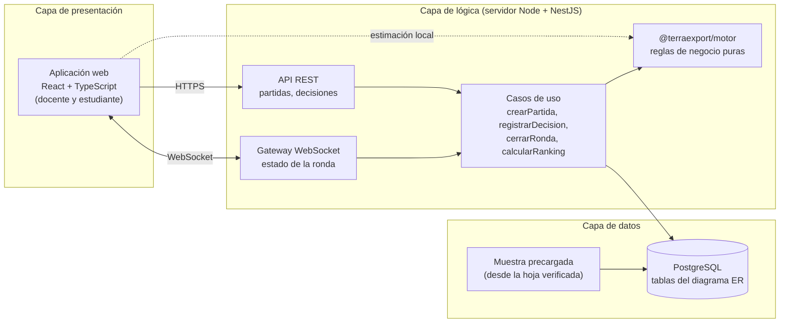
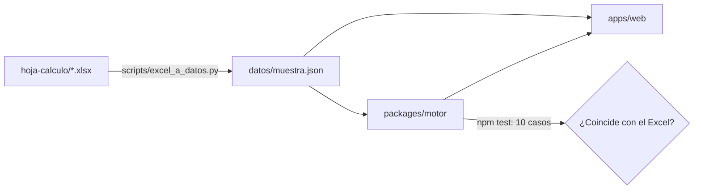

# Arquitectura de TerraExport

Este documento responde dos preguntas: con qué lenguaje se construye TerraExport y cómo se organiza
el código. Cubre el punto 7 del alcance ("arquitectura de referencia: diseño en tres capas con
despliegue en la nube") y explica la estructura de este repositorio. Las decisiones puntuales están
en `docs/adr/`.

## 1. Lo que el producto exige

Las características de TerraExport que más pesan en la elección técnica salen del propio documento
del proyecto:

| Exigencia | De dónde sale | Qué implica |
|---|---|---|
| El cálculo de costos, ventas y utilidad debe dar exactamente lo mismo que la hoja verificada | RNF-05, Sprint Backlog 1 | Un único motor de cálculo, probado contra los casos del Excel |
| El estudiante ve un costo estimado mientras decide y el resultado oficial al cerrar la ronda | RF-08, RF-09, diagrama de secuencia | El mismo motor debe correr en el navegador y en el servidor |
| La docente inicia, pausa y cierra rondas y los equipos lo ven al instante | RF-05, RF-12 | Comunicación en tiempo real (WebSocket) |
| Funciona en teléfono, computadora y proyector, sin instalar nada | RNF-03, alcance | Aplicación web adaptable |
| Solo se guarda un alias del estudiante | RNF-07, Ley 8968 | Modelo de datos mínimo, sin datos personales |
| Despliegue en la nube con presupuesto de US$ 0–25 al mes | Anexo A, estructura de costos | Servicios con capa gratuita |
| Equipo de 5 estudiantes, entregas cada dos semanas | Supuestos y restricciones | Poca infraestructura, un solo repositorio, una sola forma de probar |

## 2. Lenguaje

### Opciones evaluadas

| Criterio | TypeScript (React + Node) | PHP (Laravel) | Java (Spring Boot) | C# (.NET) | Python (Django/FastAPI) |
|---|---|---|---|---|---|
| Mismo motor en navegador y servidor | **Sí, el mismo código** | No: se duplica en JS | No: se duplica en JS | Solo con Blazor WebAssembly | No: se duplica en JS |
| Tiempo real (rondas, temporizador) | Socket.IO, nativo | Reverb/Pusher, adicional | Bien soportado | SignalR, muy bueno | Channels, adicional |
| Tipado para reglas de negocio | Estático | Parcial | Estático | Estático | Opcional |
| Hosting gratuito o casi | Muy amplio | Limitado | Limitado (consume memoria) | Moderado | Amplio |
| Curva para un equipo de 5 | Media | Baja si ya lo usan | Alta | Media-alta | Media |
| Demanda laboral en Costa Rica | Alta | Media | Alta | Alta | Alta |

### Decisión: TypeScript

La razón principal es la primera fila. Toda la credibilidad de TerraExport descansa en que el motor
de cálculo dé siempre los mismos montos que la hoja verificada. Con TypeScript ese motor se escribe
una sola vez, se prueba una sola vez contra el Excel, y lo usan tanto el navegador (estimación
mientras el equipo decide) como el servidor (resultado oficial al cerrar la ronda). En cualquier otra
opción habría dos implementaciones que pueden separarse sin que nadie lo note.

Las demás razones refuerzan la decisión: el tipado estático evita errores como sumar un porcentaje
guardado como 12 en vez de 0,12; el tiempo real es natural en Node; y el despliegue gratuito es
sencillo.

**Alternativa válida:** si el equipo ya trabaja con Laravel, es una opción razonable para el servidor.
El costo es mantener el motor en dos lenguajes (PHP para el resultado oficial y JavaScript para la
estimación) y una prueba que compare ambos contra el Excel.

## 3. Arquitectura de referencia (producto completo)

Monolito modular de tres capas con el dominio aislado (arquitectura hexagonal o de puertos y
adaptadores). No se usan microservicios: hay un solo dominio, un equipo pequeño y un presupuesto
mínimo; dividir en servicios solo agregaría costos y fallas de red.



| Capa | Tecnología propuesta | Responsabilidad |
|---|---|---|
| Presentación | React + TypeScript + Vite | Pantallas del prototipo; estimación local con el motor |
| Lógica | NestJS (Node + TypeScript), Socket.IO | Casos de uso, validación, roles (RNF-08), temporizador oficial de la ronda |
| Dominio | `@terraexport/motor` (TypeScript puro) | FOB, flete, seguro, CIF, arancel, ventas, utilidad, explicación; sin acceso a red ni base de datos |
| Datos | PostgreSQL + Prisma | Tablas del diagrama entidad-relación; la muestra se carga con un script desde el Excel |
| Nube | Frontend en GitHub Pages o Vercel; API en Render o Fly.io; base en Neon o Supabase | Todos con capa gratuita, coherente con el Anexo A |

Reglas que mantienen la arquitectura sana:

1. **El dominio no conoce a nadie.** `packages/motor` no importa React, NestJS, Prisma ni nada que
   toque red o disco. Por eso se prueba en milisegundos y se puede usar en cualquier capa.
2. **Las dependencias apuntan hacia adentro.** La web y la API dependen del motor; el motor no
   depende de ellas.
3. **El servidor manda.** El resultado que cuenta para el ranking es el que calcula el servidor al
   cerrar la ronda. El navegador solo muestra una estimación.
4. **La hoja de cálculo es la referencia.** Cualquier cambio de regla empieza en el Excel, se
   regenera `datos/muestra.json` y las pruebas confirman que el motor coincide.

## 4. Lo que existe hoy en este repositorio

> **Importante:** las secciones 2 y 3 describen la arquitectura de referencia que pide el alcance
> (punto 7) como diseño en el documento. **No se va a implementar.** El repositorio solo construye la
> demo interactiva para la presentación final (ver `docs/adr/0005-demo-sin-servidor.md`).

El proyecto entrega concepción, análisis, diseño y un prototipo; la implementación completa está
fuera de alcance. Por eso el repositorio construye solo lo necesario para el prototipo, pero ya con
la estructura de la arquitectura de referencia, de modo que el servidor pueda agregarse después sin
reorganizar nada.

```
terraexport/
├── packages/motor/        Capa de dominio. TypeScript puro + pruebas contra el Excel.
├── apps/web/              Capa de presentación (prototipo). Vite + TypeScript.
├── datos/muestra.json     Datos generados desde la hoja de cálculo.
├── hoja-calculo/          Hoja verificada (fuente de verdad de las reglas y los datos).
├── scripts/               Conversión Excel → JSON.
└── docs/                  Arquitectura, decisiones (ADR), diagramas, trazabilidad, entregas.
```

Cuando se implemente el servidor se agrega `apps/api/` (NestJS), que importa `@terraexport/motor`
igual que la web.



## 5. Buenas prácticas adoptadas

| Práctica | Cómo se aplica aquí |
|---|---|
| Control de versiones con GitHub Flow | `main` siempre publicable; una rama por RF (`feature/rf-08-decision`); cambios solo por pull request |
| Revisión por pares | Plantilla de pull request con la Definición de Terminado del documento; una aprobación obligatoria |
| Integración continua | `.github/workflows/ci.yml`: formato, tipos, pruebas y compilación en cada pull request |
| Despliegue continuo | `.github/workflows/pages.yml` publica la demo en GitHub Pages al unir a `main` |
| Pruebas de aceptación automáticas | Los 10 casos del Excel son pruebas (`packages/motor/test`); si una regla cambia en un lado y no en el otro, falla |
| Tipado estricto | `strict` y `noUncheckedIndexedAccess` en TypeScript |
| Estilo uniforme | Prettier + EditorConfig; nadie discute de formato en las revisiones |
| Decisiones documentadas | ADR en `docs/adr/`, una por decisión importante |
| Trazabilidad | `docs/trazabilidad.md` une RF, pantalla, hoja y diagrama |
| Versionado por entrega | Etiquetas `v0.1.0` (Avance I), `v0.2.0` (Avance II), `v1.0.0` (presentación final) |
| Privacidad por diseño | Solo alias de estudiantes, sin datos personales (RNF-07, Ley 8968); `.env` fuera del repositorio |
| Accesibilidad | Contraste AA, foco visible, etiquetas en formularios, movimiento reducido (RNF-02) |
| Dependencias fijadas | Versiones exactas en `package.json` y `package-lock.json` versionado |

## 6. Decisiones pendientes para la implementación completa

- **Aritmética de dinero.** El motor usa números de punto flotante redondeados en cada paso porque
  así calcula Excel y RNF-05 exige que coincidan. Si la plataforma llega a cobrar dinero real (no es
  el caso de la simulación), se debe pasar a enteros en centavos o a una librería decimal.
- **Actualización de datos.** El consumo automático de las APIs de UN Comtrade, WITS y el BCCR está
  fuera de alcance. Cuando se implemente, debe pasar por la misma hoja o por un proceso equivalente
  que conserve fuente y fecha de corte (RNF-06).
